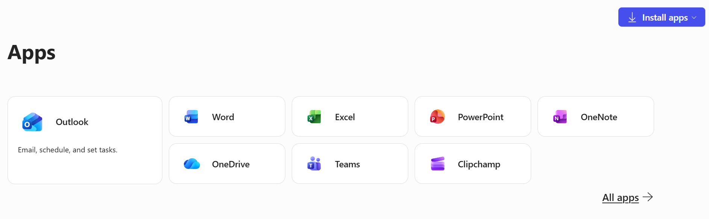

# Getting Started with Course Software

*Module: Unit 1: Developing Skills in Data Analysis > Course topics and training*

# Getting Started with Course Software

---

In our course, we will be using a broad range of software to ensure that you are competent and confident with accessing and using data. Do not worry if you have never worked in any of these programs, the course is designed to ensure that we start from scratch. If you have used these programs before, you may feel free to skip over videos where you have already mastered the skills.  I've have linked a few helpful introductory videos here to help you get acquantied (or reaquainted) with these software tools.

---

### Excel

All of you have access to Microsoft Excel through your Office 365 on your Western accounts. For our class, you need to download the desktop application. You can log into your account with your Western credentials <https://m365.cloud.microsoft/apps> and then click on “Install apps” in the top right corner to install Excel on your desktop (shown in the screenshot below).

I'm sure many of you are already familiar with Excel; however, if you need a bit of an introduction to fundamentals of how Excel works, can you view the video below from Kevin Stratvert :  
  
<https://youtu.be/Ai0MV7twEBE?si=eqUe3eA4z3LR2SPx>

---

### QGIS

QGIS is an open-source geographic information systems program (GIS). This program is compatible with both Macs and PCs. You can download QGIS from here - <https://qgis.org/>

Please be aware that if you are a Mac user, you will need to ensure that your operating system (OS) is updated to the latest version and you may need to approve the app download in your security settings.  You can download the most updated version for Mac [here](https://qgis.org/download/), which should be sufficient for our purposes.

**For everyone, I would recommend download the Long Term Release (LTR) version of QGIS.**

Statistics Canada has developed an introductory video on QGIS, which you can access below to gain a better understanding of why we will be analysing spatial data with QGIS.

- [What is GIS, and why use QGIS?](https://publications.gc.ca/collections/collection_2020/statcan/892-00005/CS892-00005-2019-1-eng.mp4)

  

---

### Positron and R

Many of you may already have some experience using R and the open-source code editor RStudio. Posit, the company behind RStudio, has recently released a new code editor called Positron.

Positron builds on many of the strengths of RStudio while offering additional tools for working with and exploring data. I think its workflow will not only make data analysis more intuitive, but also help you develop stronger skills in R as you work through the course.

You can download Positron here - <https://positron.posit.co/download.html>

- [A quick tour of Positron](https://youtu.be/4Ir_HX4riHw?si=0fuNr--GY0eupLZe)
  - This is a very quick introduction to the layout of Positron, which may look a bit familiar if you have used RStudio in your undergraduate courses. We will be going over the set-up and layout of Positron in more depth through the class material.

*R Language*

Positron will be your code editor, but you still need to download R for your computer here ([https://cran.r-project.org/](https://cran.r-project.org/)).  You will want to download the base version of R for your operating system (current version is 4.6.1). Once you have that version downloaded, it will automatically be detected by Positron.

R is an object-oriented programming language that is extremely popular for data analysis. We will be using R, and particularly a group of packages called The Tidyverse,  extensively for data analysis in the course. Before the course begins, you should watch the following video, but feel free to skip sections if you are already comfortable with those skills.

- [R programming in one hour - a crash course for beginners](https://www.youtube.com/watch?v=eR-XRSKsuR4)
  - Note, this is a fairly quick (he literally speaks quite quickly) to the overall R language. We are going to be going over all of the things covered in this video, so you don't need to walk away from this video with a deep understanding of R,  but it is an excellent introduction to many of the functions and packages (e.g., ggplot2) that we are going to be using.

---

### Python

Depending upon our progress in the course, we are planning to explore the use of Python for large-scale geospatial analysis.   
I will revisit this as the course progresses and add additional instructions here as needed, but for now, there is no further action to be taken.

