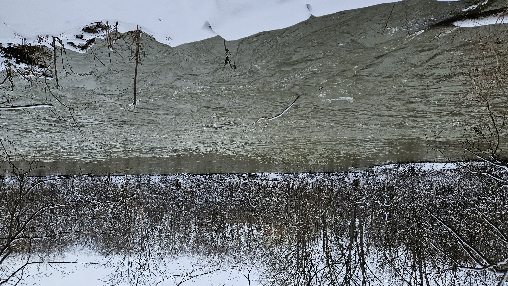

# Lesson 5 overview

*Module: Unit 1 Classes: Core Technical Skills > Class 5 - Troubled Waters: A History of Pollution in Canadian Waterways*

# Troubled Waters:  A History of Pollution in Canadian Waterways

---

Living in Southwestern Ontario, we are directly connected to the Laurentian Great Lakes, one of the largest freshwater systems on the planet. These lakes provide drinking water to London, recreation, transportation, and fisheries, but they also face persistent threats from pollution and environmental change. In this lesson, we will examine some of the most important pollutants affecting our local freshwater systems.  One area of focus will be eutrophication and the its primary causes (agriculture, wastewater, etc.) and consequences (e.g., harmful algal blooms). We will also take a historical look back at acid rain, once a major driver of ecological damage across Ontario, to understand its causes, impacts, and how coordinated policy efforts helped bring the problem under control.

**Environmental Analysis Learning Objectives**

- Perform data joins to combine datasets from multiple sources, including attribute joins, spatial joins, and joins by location.
- Integrate and merge data in Excel, R, and QGIS to support more complex analyses.
- Extract and link spatial information by sampling raster and vector values and joining them to vector datasets for further analysis.

**Lesson outline**

1. Pre-class work review (1 hour)
2. Case study #5: Exploring sulfate concentrations and the Provincial Water Quality Monitoring Network (2 hours)
3. Introduction to the NPRI assignment (30 minutes)

[Topic 5 in-class script.R](<../sources/files/Topic 5 in-class script.R>)

