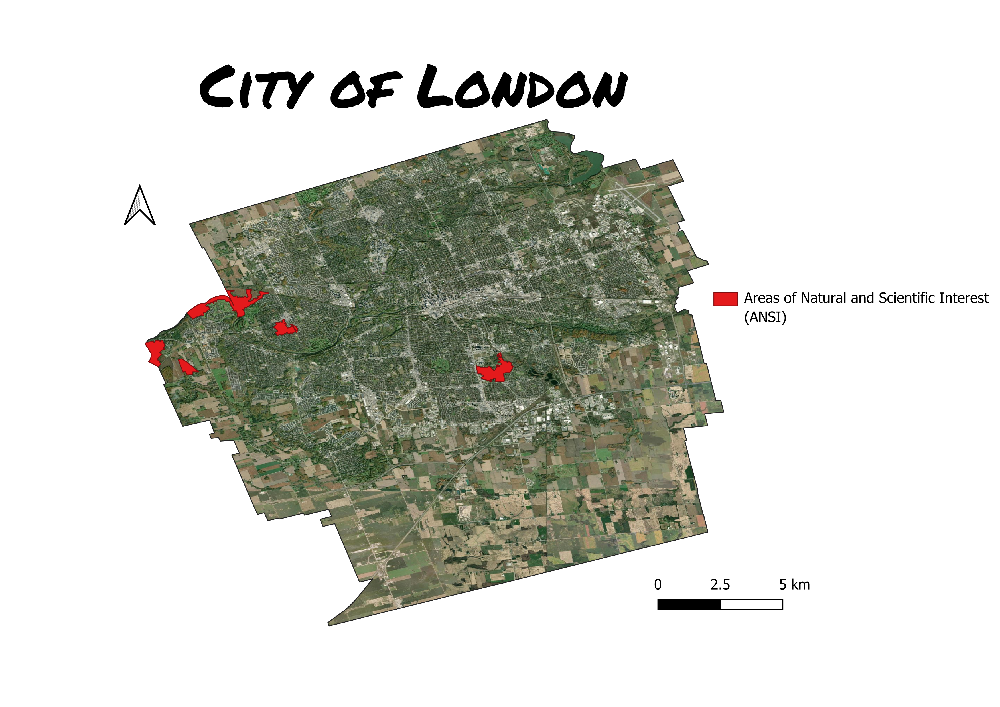

# Lesson 7 Overview

*Module: Unit 1 Classes: Core Technical Skills > 7 - Forecasting Footprints: Canada’s GHG Emissions and Climate Action*

# Forecasting Footprints: Canada’s GHG Emissions and Climate Action

---

**Lesson outline**

1. Topic 7 practice question (15 minutes)
2. NPRI Project (15 minutes)
3. Buckthorn R script (45 minutes) - [Topic 7.R](<../sources/files/Topic 7.R>)
   1. [buckthorn\_updated.csv](../sources/files/buckthorn_updated.csv)
4. Case study -  Forecasting Footprints: Canada’s GHG Emissions and Climate Action lecture (2 hours)

---

Recreate the map below using the following from the [Topic 7 dataset](<../sources/files/Topic 7.zip>):

- ansi
- municlow

