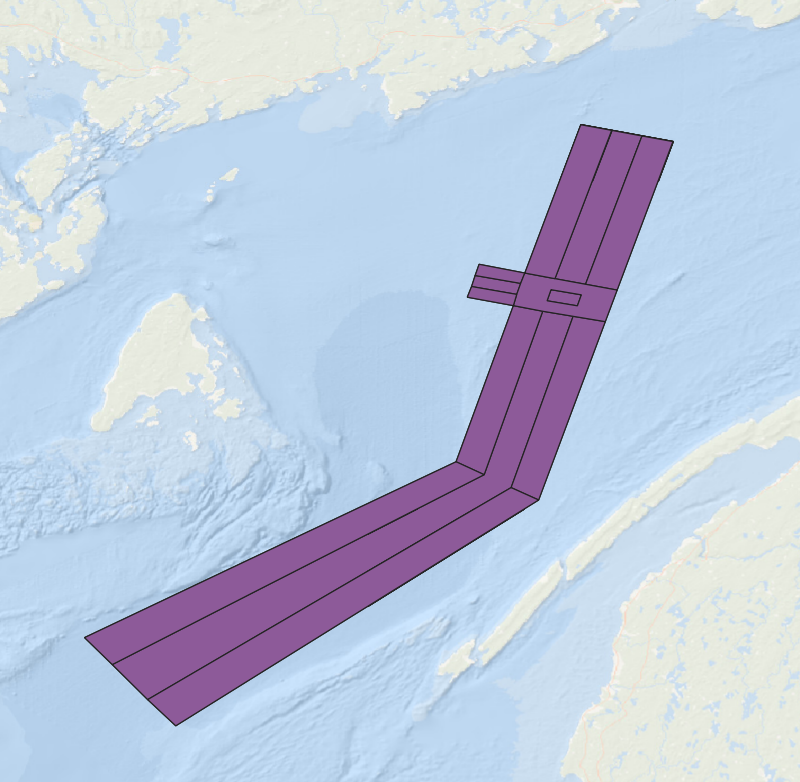

# Practice 1 - North Atlantic Right Whale

*Module: Assessments > Exams*

## Table of contents

- [Working through the activities](#working-through-the-activities)
- [Case study 1: North Atlantic Right Whale](#case-study-1-north-atlantic-right-whale)
  - [Files you need](#files-you-need)
  - [Excel](#excel)
  - [QGIS](#qgis)
  - [R](#r)

# ENVRSUST 9014 - Practice

Practice set #1: North Atlantic Right Whale

## Working through the activities

Activities use a software–section–question code: E for Excel, Q for QGIS, R for R. For example, E.1.1 is the first Excel question in case study 1. Numbering restarts for each software within each case study. For R questions, go through it in your own R script.

I’ve included little “Get help” foldouts under each question which should guide you to the correct answer; however, you should attempt each question before opening the “Get help” foldout (otherwise you will be defeating the purpose of the practice!).

# Case study 1: North Atlantic Right Whale

## Files you need

- `OBIS - North Atlantic Right Whale reduced.csv`
- Vessel route shapefile

## Excel

### E.1.1

Import the CSV using Power Query (use Transform) and inspect the complete dataset. Locate the following information within the dataset:

- coordinates
- dates
- years
- whale counts (what are they listed as?)

1. The eventDate column has a range of dates. Try to parse out as many dates as you can from the column.
2. We want to examine seasonal aspects of the sightings, so create new column that provides the month (use the eventDate\_standard column for this)
3. Null values in the `individualCount` column represent sightings where a whale was seen, but the number of whales was not recorded. Let’s make an assumption that these values were just a single whale and correct the data accordingly.
4. Once you exit the PowerQuery editor, make sure you save your adjusted dataset as a new csv `OBIS - North Atlantic Right Whale updated.csv`

TipGet help

- Use Data → From Text/CSV → Transform Data.
- In Power Query, profile the entire dataset and check they key column types for any missing values.
- Add column in the Power Query editor and select the eventDate\_standard
- Convert through the null values within the `individualCount` column to a value of 1 using either the replace values option in PowerQuery or within the table, selecting blanks and flashfilling the number 1 down the column

### E.1.2

The bathymetry column has the estimated depth of the whale sightings for that row. However, some bathymetry values appear to be on land (i.e. they have negative values). Create a new bathymetry column called “corrected\_depth” and set all the negative values to be 0.

1. Try this via the column filter
2. Try using an if function.

TipGet help

- You can initially use the column filter to select any values below zero and then replace then with 0 using a flashfill
- To use an IF statement, you want `=IF([@bathymetry] <0, 0,[@bathymetry])`. Within Excel, we technically only used character strings, but you might have recognized that when we were using IF statements within R you can have the “FALSE” part of the IF statement just be the results in the column. So, the IF statement above reads “If the values are less than 0, then replace those values with 0, otherwise, just use the value that is already listed in the bathymetry column”

### E.1.3

1. Create a PivotTable showing the *number of sighting records* (not total sightings) by `institutioncode`. How many records have no institution recorded?
2. Sort the data by the institutions that have the highest number of sightings
3. Remove the sightings that have no institution recorded and drop any institutions that have fewer than 10 sightings recorded
4. Create a PivotChart to show how the institutions vary in their number of sightings

TipGet help

- Insert a PivotTable from the cleaned table. Make sure that the entire table is selected when you create your PivotTable (selecting cell A1 will do this for you).
- Put institution into the rows and then also put it into the values section (it should by default select count for you)
- Use the drop-down filter to remove the rows that have no institution recorded
- Use the same filter, using either the tick boxes to remove those institutions that have low sightings or use the value filters to remove anything less than 10
- Insert a PivotChart

### E.1.4

1. Create a second PivotTable showing the sum of `individualCount` in each year.
2. Change the pivot chart to look at the number of sightings in each year.

Do the two summaries show the same pattern? Think about what the differences are between what they measure.

TipGet help

- Put `year` in Rows and `individualCount` in values
- Set value field to Sum
- Switch the value field to look at count instead of sum
- Compare the two pivot charts and examine the similarities and differences between them

### E.1.5

Create a PivotTable showing the number of total number of sightings observed by calendar month, pooled across years. Which months have the most records, and how could observation effort affect this pattern?

TipGet help

- Put `month` in Rows and Count of id in Values.
- Sort months numerically from 1 to 12

### E.1.6

Create a PivotChart that shows the total number of sightings in the following three categories: - 1 whale seen - 2-10 whales seen - More than 10 whales seen

TipGet help

- You want to create a new column that creates three new categorical variables
- The easiest approach here is to use an IFS statement
- `=IFS([@individualCount]>10, "More than 10", [@individualCount]> 1, "Between 2 and 10", [@individualCount] =1, "Only 1")`

### E.1.7

Create a dropdown box to select institutions and then populate a cell with the number of sightings when an institution is selected from the dropdown box.

TipGet help

- For this question, you want to get the unique names of each institution using the `UNIQUE` function in Excel. I would recommend doing this on a separarte sheet.
- Then you need to create a cell that has data validation using the list of the unique vales
- Then you want a cell that uses COUNTIF with an institution from the dropdown box as the criteria.
- You can review the steps needed to complete this task in this video - https://westernu.brightspace.com/d2l/wcs/mp/mediaplayer.d2l?ou=198357&entryId=b068f205-e763-447f-97ee-b96d261ac420%2flatest&type=video&d2lrnc=acm52l7contentca-central-13ZwHpDhD8NbH9dCF5qzbbyvideo5mSBNOmYiGiTtjhKuCyEwM%252flatest

## QGIS

### Q.1.1

1. Load the `OBIS - North Atlantic Right Whale updated.csv`as a point layer (the one that has months in it now from above) using with WGS 84 (EPSG:4326) as the source CRS. Add the ocean basemap and inspect the sighting locations and attributes.
2. Identify any records that are showing as having a bathymetry less than 0. Explore the map where these sightings have been located. Clear the filter once you have done that.
3. Use the symbology to identify points that have bathymetry below zero and and those that have a bathymetry above zero.

TipGet help

- Add Delimited Text Layer using longitude as X and latitude as Y.
- Assign EPSG:4326 to the supplied geographic coordinates.
- Add a basemap using QMS and inspect the locations.
- Use a filter to initially find points that are recorded as being on land, then clear the filter
- Use the field calculator to create a new text column (you must change the Output field type). Use an IF statement to create the new column - `IF( "bathymetry" <0, 'On land', 'On Water')`
- QGIS video - https://westernu.brightspace.com/d2l/wcs/mp/mediaplayer.d2l?ou=198357&entryId=a90949ef-8dd2-4096-be6a-cb03f670b0bb%2flatest&type=video&d2lrnc=acm52l7contentca-central-13ZwHpDhD8NbH9dCF5qzbbyvideo58XWN6MRLM6HNOzsVeKXcn%252flatest

### Q.1.2

1. Load the vessel route layers for:

- `TSSLPT_A.shp` (traffic separation lanes)
- `TSEZNE_A.shp` (area seperating the traffic separation lanes)

Zoom in on the Bay of Fundy (where most of the whale sightings are). The traffic separation lanes are the pathways that vessels take to avoid each other and the area separating the traffic separation lanes is a buffer between those vessel lanes.

2. Create a single vector layer that contains bother the traffic separation lanes and the buffer zone between them (you can ignore any errors about field length)
3. Select the routes in the Bay of Fundy study area picture below and then save those features as a separate layer.



TipGet help

- Load the vessel routes listed by dragging and dropping them into the map canvas
- Merge the two polygon layers by going to Vector → Data Management Tools → Merge Vector layers
- Select or filter Bay of Fundy routes by selecting the features using the select features button in QGIS. You can drag a box around all the features or alternatively use control to select all of the polygons in the Bay of Fundy you want to merge.
- Save selected routes as a geopackage or shapefile by right-clicking on Export - Save Selected Features as. Make sure you use the three dots!

### Q.1.3

1. Change the symbology of the whale sightings to represent the month of each sighting. Style the vessel routes so they remain visible beneath the points.
2. Change the symbology on the vector layers to show the total number of sightings within each poloygon feature to identify areas where there is high potential for ship strike.
3. Create count layers that have counts for different May and August to see if there are any monthly patterns in where ship strike is likely to occur.

TipGet help

- Open Layer Properties → Symbology → Categorized and classify sighting points using month.
- You must use Count Points in Polygon to determine how many points are within the polygon layers that you merged in the previous question
- Filter the original points data for the two different months and re-run the count points in poloygon feature
- You can flash between the two layers you’ve created, but be mindful of the differences in the the symbology classifications

### Q.1.4

Even if some sightings don’t overlap with the vessel routes, they may be quite close to them. Calculate the distance between each point and the nearest vessel route (NAD83 / UTM zone 20N — EPSG:26920). What does a distance of zero mean?

TipGet help

- Reproject both working layers to a suitable projected CRS with metre units - NAD83 / UTM zone 20N — EPSG:26920
- Run Join attributes by nearest with sightings first, routes second.

### Q.1.5

Use Field Calculator to create a distance field in kilometres. Filter the result to sightings within 5 km of a mapped route and record how many sighting records meet this condition. Then change the point symbology to represent distance from the nearest route.

Explain what proximity to a mapped route can tell you, and why it does not establish that a vessel was present when a whale was sighted.

TipGet help

- Use Field Calculator to divide the metre-distance field by 1000.
- Filter the kilometre field to values at or below 5.
- Use graduated symbology for numeric distances and inspect several features.

### Q.1.6

Create a print layout showing the Bay of Fundy sightings and vessel routes. Choose distance for the sighting symbology, and include a title, legend, scale bar. Export the map and save your QGIS project and analysis layers.

TipGet help

- Create a Print Layout and add the map by dragging and dropping.
- Add and format the legend, scale bar, title and source text.
- Export the layout and save the project with its output layers.

## R

### R.1.1

Load `tidyverse` and `janitor`, import the `OBIS - North Atlantic Right Whale reduced.csv` and clean the column names. Inspect its dimensions, data types and missing values. Create a new month column that has the labels for the month (e.g., “Jan”).

TipGet help

```
library(tidyverse)
library(janitor)

whale_data<- read_csv("OBIS - North Atlantic Right Whale reduced.csv")
whale_data <- whale_data |> 
  clean_names() |> 
  mutate(month_label = month(event_date_standard, label = TRUE))

glimpse(whale_data)
```

### R.1.2

1. Select the a set of columns needed to analyse sightings (id, year, month, individual\_count, institution\_code) through time and only include records from 2000 onward.

TipGet help

```
whale_selected <- whale_data |>
  select(id, year, month_label, individual_count, institution_code) |>
  filter(year >= 2000)
```

### R.1.3

1. Using the filtered dataset from R.1.2, calculate the sum of recorded whale counts in each month and exclude records without a year.
2. Create a column plot that shows the number whales in eaceh month and change the colour of the columns to blue and update the axis labels.

TipGet help

```
month_whales <- whale_data |>
  group_by(month_label) |>
  summarize(
    whale_count = sum(individual_count, na.rm = TRUE))|>
  filter(complete.cases(month_label))

ggplot(data = month_whales, aes(x = month_label, y = whale_count))+
  geom_col(fill = "blue") +
  labs(x = "Month", y = "Number of whales")
```

### R.1.4

1. Create a dataset that has the yearly totals of whale sightings (not sum of individuals). Create a line plot with points showing the *annual* total of whale sightings.
2. Add clear axis labels and a title, then adjust the theme (`theme_bw`). Change the line colour to purple.

TipGet help

```

annual_whales <- whale_data |>
  group_by(year) |>
  summarize(sighting_count = n())

ggplot(annual_whales, aes(x = year, y = sighting_count)) +
  geom_line(colour = "purple") +
  geom_point(colour = "purple", size = 2) +
  labs(x = "Year", y = "Whale sightings",
       title = "Whale sightings through time") +
  theme_bw()
```

### R.1.5

1. Create a dataset that only has the top five institutions for *whales seen* (sum) all time
2. Create a column plot that shows how each institution’s yearly sums have changed over time.
3. Have a different colour for each institution and plot each institution on its own “mini-plot”

TipGet help

```

top_five_institutions <- whale_data |>
  group_by(institution_code)|>
  summarize(sum_whales = sum(individual_count, na.rm = TRUE)) |>
  arrange(-sum_whales) |>
  head(5)

institution_whales <- whale_data |>
  filter(institution_code %in% top_five_institutions$institution_code) |>
  group_by(institution_code, year) |>
  summarize(whale_count = sum(individual_count, na.rm = TRUE))

ggplot(institution_whales,
       aes(x = year, y = whale_count, fill = institution_code)) +
  geom_col() + 
  facet_wrap(~institution_code)+
  labs(x = "Year", y = "Number of whales", fill = "Institution") +
  theme_bw()
```

### R.1.6

1. Create a dataset that has monthly sightings across all institutions, but have an extra column that indicates whether those were “Individual” or “Group” (any count 2 or more).
2. Create a column plot that has the total sightings count for each month but is has the bar broken into two different colours representing the group size (Individual or Group).
3. Export your plot as a PNG and the summarized dataset as a CSV.

TipGet help

```
whale_data_month <- whale_data |>
  mutate(group_size = ifelse(individual_count > 1, "Group", "Individual"))|>
  group_by(month_label, group_size) |>
  summarize(sightings_count = n())

ggplot(whale_data_month, aes(x = month_label, y = sightings_count, fill = group_size)) +
  geom_col() +
  labs(x = "Month", y = "Number of sightings", fill = "Group size") + theme_bw()

ggsave("whale_monthly_records.png", width = 18, height = 12, units = "cm")
write_csv(whale_data_month, "whale_annual_summary.csv")
```
