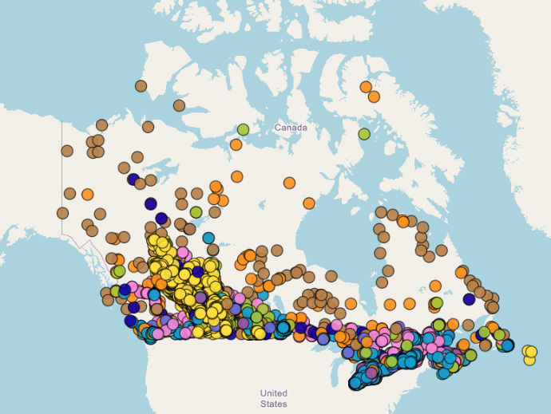

# The NPRI Dataset

*Module: Unit 1: Developing Skills in Data Analysis > Course topics and training*

# The National Pollutant Release Inventory

---

For most of our data analysis training, we will use the [**National Pollutant Release Inventory (NPRI)**](https://www.canada.ca/en/services/environment/pollution-waste-management/national-pollutant-release-inventory.html) as our foundational dataset. The NPRI is Canada's publicly accessible inventory of pollutant releases, disposals, and transfers reported annually by industrial and commercial facilities across the country. Working with a common dataset has two main advantages for us:

1. By working with a common dataset throughout the term, we can focus on building core analytical skills such as data cleaning, management, visualization, exploration, and interpretation without needing to learn a new dataset for every topic area. This allows us to progressively build our technical skills while simultaneously developing a deeper understanding of the data, its structure, and its limitations.
2. Later in the term, the NPRI dataset will form the foundation of your NPRI group project, where you will apply the methods and tools learned throughout the course to investigate an environmental question of interest. By working with the dataset throughout the term, you will be better prepared to conduct meaningful analyses, identify trends and patterns, and communicate evidence-based insights through your final project.

Before the first class, please review the following two videos:

- [The National Pollutant Release Inventory (NPRI)](https://www.youtube.com/watch?v=xP4Td5olNvs)
- [Instructional videos: National Pollutant Release Inventory - Canada.ca](https://www.canada.ca/en/environment-climate-change/services/national-pollutant-release-inventory/instructional-videos.html#excel) (How to use Excel tabular data)

In addition, it will be helpful for you to see the spatial data that is attached to the NPRI. Quickly explore the NPRI map linked below.

- [National Pollutant Release Inventory Map - Canada.ca](https://www.canada.ca/en/environment-climate-change/services/national-pollutant-release-inventory/tools-resources-data/npri-map.html)

You can download the NPRI datasets you need here:

[NPRI data.zip](<../sources/files/Class 1/NPRI data.zip>)  

You must download the folder and unzip it if you are on a Windows machine (right click, Extract All).

