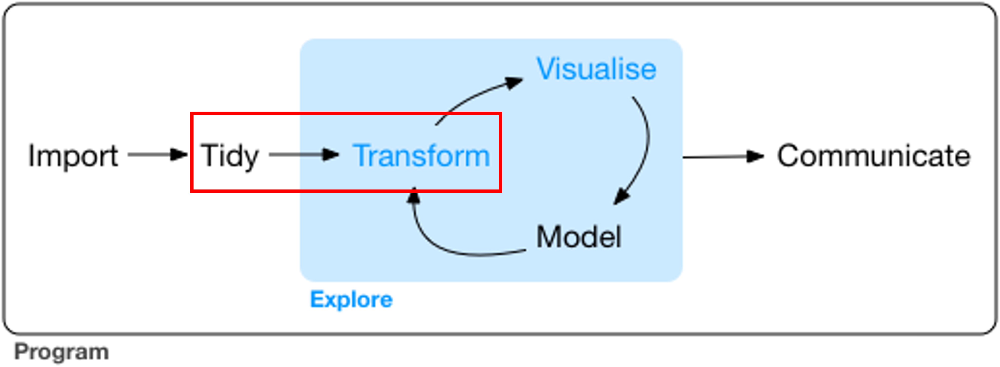

# Topic 2: Transforming and wrangling data

*Module: Unit 1: Developing Skills in Data Analysis > Course topics and training*

### 

# Topic 2: Transforming and wrangling data

---

In this topic, we will focus primarily on the task of reorganizing our datasets to prepare them for exploratory data analysis. We are going to cover

### **Excel**

- [Excel - Data and variable types](../transcripts/excel/excel-data-and-variable-types.md)
  - This video goes through loading data into Power Query and then checking for data type errors
- [Excel - Splitting columns](../transcripts/excel/excel-splitting-columns.md)
  - Here, we explore how we can separate data out from a single column to create additional variables
- [Excel - Selecting and removing columns and rows](../transcripts/excel/excel-selecting-and-removing-columns-and-rows.md)
  - Quick introduction to removing columns and rows as well as removing blanks and duplicates
- [Excel - Pivoting columns](../transcripts/excel/excel-pivoting-columns.md)
  - This covers the very useful step of pivoting and unpivoting data into wide and long format

For the following videos, please download and import [OBIS - North Atlantic Right Whale reduced.csv](<../sources/files/Topic 2/OBIS - North Atlantic Right Whale reduced.csv>)

- [Excel - Extracting date information](../transcripts/excel/excel-extracting-date-information.md)
- [Excel - Cleaning up date data](../transcripts/excel/excel-cleaning-up-date-data.md)

### **QGIS**

In these videos, we'll look at how raster data can be added to QGIS and how we can manipulate it. We'll also explore some additional options to filter vector data.

For the videos below that involve raster import, I've sourced both raster and ESRI Rest Servers for [Marine Invasive Species](https://open.canada.ca/data/en/dataset/1439dcb3-82a6-40fd-a9a4-8f045b20ff5b) (NPRI doesn't have a good range of raster files). Download the following raster files for the green shore crab and the sea vase:

- - [Carcinus maenas.tif](<../sources/files/Topic 2/Carcinus maenas.tif>)
  - [Ciona intestinalis.tif](<../sources/files/Topic 2/Ciona intestinalis.tif>)
- [QGIS - Raster import](../transcripts/qgis/qgis-raster-import.md)
  - This video reviews how raster data can be imported into QGIS and how we can alter the symbology for visualization
- [QGIS - Raster calculator](../transcripts/qgis/qgis-raster-calculator.md)
  - Using the raster calculator to "filter" raster data by pixel values
- [QGIS - ESRI Rest Servers](../transcripts/qgis/qgis-esri-rest-servers.md)
  - Introduction to the use of rest servers for importing data into QGIS
- [QGIS - Filter vector data for multiple conditions](../transcripts/qgis/qgis-filter-vector-data-for-multiple-conditions.md)
  - A review of how to filter vector data for multiple conditions in the dataset

### **R**

We will review our R work in class again and cover the following:

- Positron  - Data types
- Positron - Date formatting
- Positron  - Factor manipulation

*Reshaping data*

- Positron  - Filtering data for multiple conditions
- Positron -  Pivoting data

